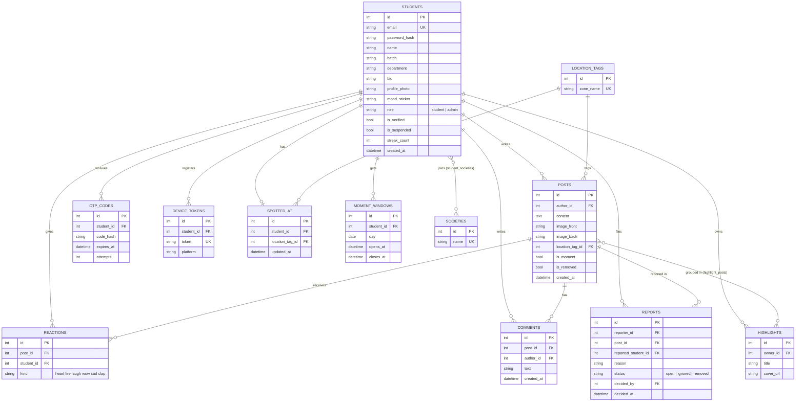

# Entity Relationship Diagram

Source of truth for the database. Implemented in `backend/app/models.py` and the Alembic migration `0001_initial_schema`.

## Constraints worth knowing

- One reaction per student per post: unique `(post_id, student_id)`.
- One report per reporter per post, and per reporter per reported student (API returns 409 on a duplicate).
- `MOMENT_WINDOWS` holds each student's own random daily IBA Moment time and its 2-minute close (API `GET /moments/current`): unique `(student_id, day)`.
- OTP codes are stored hashed and expire; `attempts` supports the 429 rate limit.
